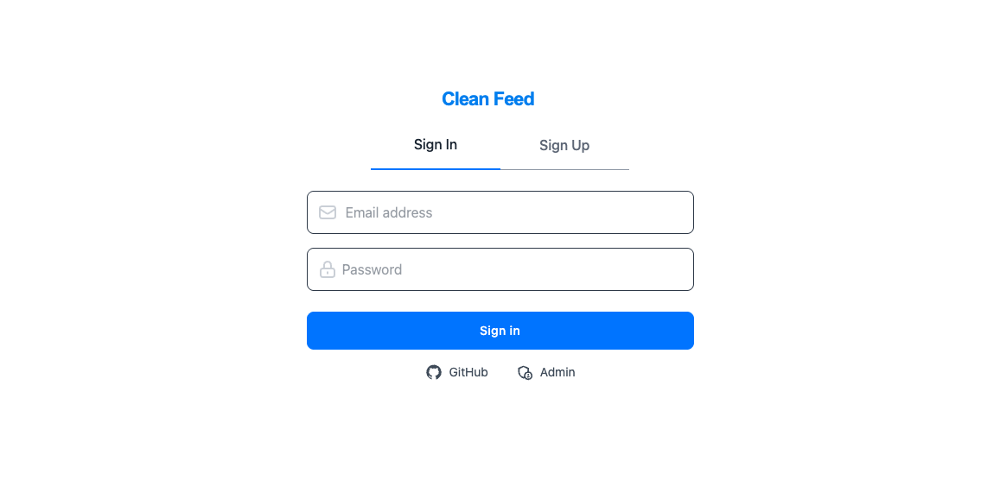

# Clean Feed

A social networking platform with automated content moderation and context-based authentication system.



## Table of Contents

- [Project Overview](#project-overview)
- [Features](#features)
- [Technologies](#technologies)
- [Schema Diagram](#schema-diagram)
- [Getting Started](#getting-started)
- [Usage](#usage)
- [License](#license)

## Project Overview

The project is a social networking platform built using the MERN (MongoDB, Express.js, React.js, Node.js) stack. It incorporates two major features: an automated content moderation system and context-based authentication. These features are accompanied by common functionalities found in social media applications, such as profile creation, post creation and sharing, liking and commenting on posts, and following/unfollowing users.

### Automated Content Moderation

The platform's automated content moderation system utilizes various NLP (Natural Language Processing) APIs. These APIs include:

- Perspective API: Used for filtering spam, profanity, toxicity, harassment etc.
- TextRazor API: Integrated for content categorization.
- Hugging Face Interface API: Utilized with BART Large MNLI for content categorization.

A Flask application has been developed to provide similar functionality as the Hugging Face Interface API's classifier. The Flask app utilizes the BART Large MNLI model. It operates as a zero-shot classification pipeline with a PyTorch framework.

The system allows flexibility in choosing different services for API usage or disabling them without affecting overall functionality by using a common interface for interacting with the APIs.

When a user posts content, it undergoes a thorough filtering process to ensure compliance with the community guidelines. Additionally, users have the ability to report posts that they find inappropriate, which triggers a manual review process.

### Context-Based Authentication

The platform implements context-based authentication to enhance user account security. It takes into consideration user location, IP address, and device information for authentication purposes. Users can conveniently manage their devices directly from the platform. To ensure data privacy, this information is encrypted using the AES algorithm and securely stored in the database.

In case of a suspicious login attempt, users are promptly notified via email and are required to confirm their identity to protect against unauthorized access.

### User Roles

There are three distinct user roles within the system:

1. Admin: The admin role manages the overall system, including moderator management, community management, content moderation, monitoring user activity, and more.
2. Moderators: Moderators manage communities, manually review reported posts, and perform other moderation-related tasks.
3. General Users: General users have the ability to make posts, like comments, and perform other actions within the platform.


## Features

- [x] User authentication and authorization (JWT)
- [x] User profile creation and management
- [x] Post creation and management
- [x] Commenting on posts
- [x] Liking posts and comments
- [x] Following/unfollowing users
- [x] Reporting posts
- [x] Content moderation
- [x] Context-based authentication
- [x] Device management
- [x] Admin dashboard
- [x] Moderator dashboard
- [x] Email notifications


## Technologies

- React.js
- Redux
- Node.js
- Express.js
- MongoDB
- Tailwind CSS
- JWT Authentication
- Passport.js
- Nodemailer
- Crypto-js
- Flask
- Hugging Face Transformers


## Schema Diagram


## Getting Started

### Prerequisites

For the local setup, install:

- Node.js 24+ and npm
- Docker, or a local MongoDB 7 installation

### Installation

1. Clone the repository into a Clean Feed directory:

```bash
git clone https://github.com/nz-m/SocialEcho.git clean-feed
cd clean-feed
```

2. Install the client and server dependencies:

```bash
cd client
npm ci
cd ../server
npm ci
cd ..
```

3. Start a local MongoDB database in Docker:

```bash
docker run --name clean-feed-mongodb -p 27017:27017 -d mongo:7
```

If you already have MongoDB running locally, you can skip this step. To start the Docker database again after stopping it, run `docker start clean-feed-mongodb`.

4. Configure the environment files:

```bash
cp server/.env.example server/.env
cp client/.env.example client/.env
```

The server example uses the local database `db_clean_feed`. Set unique values for `SECRET`, `REFRESH_SECRET`, and `CRYPTO_KEY` in `server/.env`. They can be generated with:

```bash
node -e "console.log(require('crypto').randomBytes(32).toString('hex'))"
```

Run this command separately for each secret. Local development does not require email credentials or external content-moderation API keys.

### Run and test in a browser

Start the backend from the `server` directory in one terminal:

```bash
cd server
npm start
```

Start the frontend from the `client` directory in another terminal:

```bash
cd client
npm start
```

Open [http://localhost:3000](http://localhost:3000) in your browser. The frontend calls the local API at `http://localhost:4000`; keep MongoDB and both development servers running while using the app.


### Configuration

Admin setup is optional for general user registration. To configure an admin account and initialize communities, run `./admin_tool.sh` from the `server` directory after configuring `server/.env` and starting MongoDB.
```bash
./admin_tool.sh
``` 

#### `.env` Variables

Email verification and suspicious-login emails are optional. Configure these values only if you want to send email:

```bash
EMAIL=
PASSWORD=
EMAIL_SERVICE=
```

External content-moderation providers are optional. Configure the provider keys in `server/.env` only if you want to use those services:

- [Perspective API](https://developers.perspectiveapi.com/s/docs-get-started)
- [TextRazor API](https://www.textrazor.com/)
- [Hugging Face Interface API](https://huggingface.co/facebook/bart-large-mnli)

The Flask classifier can also run locally as an alternative to the hosted classification APIs. It downloads the model the first time it runs; see [classifier_server/Readme.md](./classifier_server/Readme.md).


> **Note:** Local MongoDB is required. Email delivery and external content-moderation APIs are optional and are not needed to run the application locally.


## Usage

### Admin

The admin dashboard can be accessed at the `/admin` route. Use the `admin_tool.sh` script to configure the admin account. The admin account can be used to manage moderators, communities, and perform other admin-related tasks. You can also enable/disable or switch API services using the admin dashboard.

### Moderator

For local testing, registering with an address ending in `@mod.cleanfeed.test` assigns the moderator role. Moderators can be assigned to communities from the admin dashboard.

#### Demo
https://youtu.be/Tmncayg7FeU

## License

This project is licensed under the [MIT License](https://github.com/nz-m/SocialEcho/blob/main/LICENSE).
